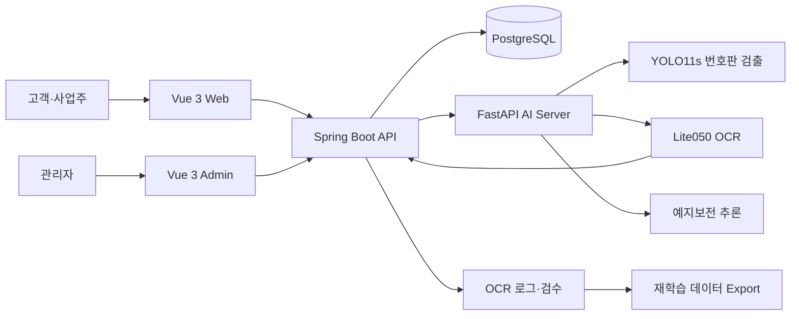

# CLOUDWASH

> AI 번호판 인식을 입차·예약·세차·결제·출차와 관리자 검수까지 연결한 무정차 자동 세차 운영 프로토타입

지원용 요약: [AI 서비스 개발 엔지니어 1페이지 포트폴리오](SUBMISSION_PORTFOLIO.md)

## 프로젝트 요약

| 항목 | 내용 |
|---|---|
| 과정 | [에스트래픽] 스마트 모빌리티 DX Academy 4기 |
| 기간 | 2026.06.30 ~ 2026.09.02 |
| 인원 | 4명 |
| 형태 | KDT 풀스택 팀 프로젝트 |
| 핵심 역할 | OCR 데이터·모델 개발 및 AI 서비스 연동, 차량 상태 제어 |
| 포지셔닝 | AI 모델을 실제 운영 서비스로 연결할 수 있는 백엔드·풀스택 개발자 |

CLOUDWASH는 차량 번호판을 자동으로 인식하고 회원·예약·결제 정보와 연결해 입차부터 출차까지 처리하는 무인 세차장 소프트웨어 프로토타입입니다. 고객·사업주·관리자 화면, Spring Boot 업무 서버, PostgreSQL, FastAPI 기반 OCR·예지보전 서비스를 하나의 흐름으로 통합했습니다. 실제 차단기·세차기 하드웨어는 연결하지 않고 웹 화면과 API 요청으로 장비 이벤트와 상태 전이를 시뮬레이션했습니다.

예지보전은 선도기업 에스트래픽 실무 담당자가 제공한 프로젝트용 합성 센서 데이터를 사용한 개발환경 검증입니다. 실제 장비 운영 성능이 아니라 모델 선택·운영 지표 설계와 서비스 통합 가능성을 확인한 보조 AI 사례로 제시합니다.

## 핵심 결과

| 결과 | 수치 및 근거 |
|---|---|
| OCR 데이터 구성 | AI Hub 7·8자리 61,922장 선별, 실환경 10,000장 분리 |
| YOLO 실환경 개선 | 탐지 실패 732장 재라벨링 후 Hard Sample 재학습 |
| 최종 OCR | Lite050 1,140,503 parameters, CRNN의 약 48%·CNN-only Base의 약 25% |
| OCR 잠금 테스트 | 실사 Crop 1,000장 문자열 완전 일치 97.1% |
| 입력 규격 | grayscale 1×48×192, 54문자 + CTC blank |
| 품질 검증 | 2026-07-31 기준 통합·자동 검증 200개 항목 PASS |

OCR 성능은 학습과 튜닝에서 분리한 실사 Crop 1,000장 locked test 결과입니다. 번호판 탐지부터 포함한 end-to-end 정확도가 아니며, 후속 corrected-v2 평가는 별도 버전으로 관리해 대표 수치와 혼용하지 않습니다.

## 해결하려던 문제

일반적인 무인 세차장 시스템은 차량 식별, 예약, 세차, 결제와 장비 관리가 분리되어 있습니다. 번호판 OCR을 추가하더라도 오인식이 발생하면 잘못된 차량·입차 데이터가 누적될 수 있습니다.

CLOUDWASH는 다음 세 문제를 중심으로 설계했습니다.

1. 다양한 촬영 환경에서도 사용할 수 있는 번호판 인식 모델 구축
2. OCR 결과를 차량의 실제 입차·세차·출차 상태와 안전하게 연결
3. 오인식을 운영자가 교정하고 재학습 데이터로 환류

## 시스템 구성



## 핵심 서비스 흐름

```text
차량 촬영
  → YOLO 번호판 검출
  → Lite050 문자 인식
  → 회원·차량·블랙리스트 확인
  → 예약 또는 현장 차량 판별
  → 입차
  → 세차 완료
  → 결제 상태 확인
  → 출차
```

운영자는 OCR 로그에서 원본 이미지, 탐지 영역, 번호판 문자열과 신뢰도를 확인합니다. 오인식은 번호판과 bounding box를 수정하고 학습 후보로 지정해 ZIP으로 내보낼 수 있습니다.

## 나의 주요 기여

### 1. 용도별 번호판 데이터 구성과 OCR·YOLO 모델 개발

- AI Hub 90,000장 데이터 풀을 감사하고 1줄·7~8자리 정규 번호판 61,922장을 OCR 학습·검증용으로 선별
- 광안대교 실환경 10,000장을 학습 8,100장, 검증 900장, locked test 1,000장으로 분리
- Roboflow bbox 데이터로 YOLO를 학습하고 실환경 탐지 실패 732장을 직접 재라벨링해 Hard Sample로 재학습
- 2단·지역명 포함 장문 번호판은 별도 처리해야 할 향후 과제로 분리
- CRNN, STN-CRNN, PlateCNNCTC, PaddleOCR, PARSeq 계열 학습·비교
- 입력 규격, 문자셋, CTC 시간축과 증강 정책 설계
- CNN-only Base의 과도한 채널 수를 확인하고 Lite075·Lite050으로 경량화
- 모델 크기와 실사 일반화 성능을 함께 고려해 Lite050 + Beam Search 5 + 번호판 형식 우선 decoder 선택
- 완전 일치율, CER, 번호판 길이·품질 군집별 성능과 CPU/GPU 지연시간 평가

### 2. OCR을 운영 가능한 입차·검수 시스템으로 확장

- FastAPI–Spring 간 이미지 요청·OCR 응답 구조 설계 및 REST API 구현
- 단위 테스트와 통합 실행 환경의 입차 흐름으로 소프트웨어 동작 검증
- 인식 결과·신뢰도·원본 이미지·탐지 좌표 저장
- 시연 요청과 실제 운영 로그 생성 분리
- 관리자 번호판 문자열·bounding box 교정 UI
- 검수 데이터를 재학습 후보로 지정하고 이미지·수정 정보를 ZIP으로 내보내 OCR·YOLO 후속 학습에 활용하는 기능

### 3. 입차부터 출차까지 상태 불변조건 구현

- 미등록·비활성 장비 요청 차단
- 입차·세차·출차 장비 유형 검증
- 동일 차량 중복 입차 방지
- 세차 미완료 차량 출차 차단
- 회원·비회원 및 예약·비예약 차량 흐름 처리
- 번호판 정규화와 중복 차량 등록 방지

### 추가 기여

- 차량 논리 삭제와 블랙리스트 관리
- 기상청 API 기반 날씨 정보
- 예약·현장 차량 흐름 공동 보완
- 단위·OCR·통합 테스트와 운영체제 경로 호환성 개선
- 예지보전 모델 실험 결과 검토, L2 로지스틱 회귀 선정 및 FastAPI·Spring·관리자 화면 통합 검증

## 기술 스택

| 영역 | 기술 |
|---|---|
| Frontend | Vue 3, Vite, Pinia, Vue Router, Axios, PrimeVue, Plotly.js |
| Backend | Java 17, Spring Boot, Spring Security, JWT, MyBatis, Gradle |
| Database | PostgreSQL |
| AI | Python, PyTorch, Ultralytics YOLO11s, OpenCV, scikit-learn |
| AI API | FastAPI, Uvicorn |
| Test | JUnit 5, Spring Security Test, pytest, unittest |
| Operation | Spring Actuator, Prometheus Metrics, Git/GitHub |

## 담당 범위

OCR 데이터·모델 개발, OCR 서비스 연동과 검수, Gate 상태 제어, 차량·블랙리스트와 예지보전 통합을 담당했습니다. 결제, 지도, 소셜 로그인, 정산과 혜택은 다른 팀원이 중심적으로 구현했으며, 예약·비회원 결제·관리자 통합 화면에서는 OCR 입차 및 차량 상태 흐름과의 연동과 통합 검증에 참여했습니다.

## 상세 문서

- [민감정보를 제거한 공개용 소스 코드](source/README.md)
- [프로젝트 개요](docs/01_project_overview.md)
- [나의 역할과 기여](docs/02_my_contributions.md)
- [문제 해결 사례: 실사용 OCR 모델 선택](docs/03_case_study_ocr.md)
- [문제 해결 사례: OCR 오인식 검수와 재학습 데이터 환류](docs/04_case_study_ocr_feedback_loop.md)
- [문제 해결 사례: 입차·세차·출차 상태 제어](docs/06_case_study_gate_state.md)
- [데이터와 소스 공개 범위](docs/10_publication_scope.md)

## 데이터와 소스 공개 범위

이 저장소는 분석 과정과 구현 결과를 설명하는 포트폴리오 문서와 민감정보를 제거한 애플리케이션 소스 코드를 공개한다. 학습·검증 원본 데이터와 실제 실행 비밀정보는 공개하지 않는다.

- AI Hub 원본 이미지·라벨: 비공개
- Roboflow 원본 이미지·bbox 라벨: 비공개
- 에스트래픽 제공 광안대교 실사 이미지: 비공개
- 에스트래픽 제공 예지보전 합성 센서 원본: 비공개
- 차량 번호·계정·결제 정보가 포함된 로그와 DB 덤프: 비공개
- 모델 가중치: 재배포 조건 확인 전 비공개
- 공개 자료: 집계 성능 수치, 직접 작성한 구성도, 비식별 도표, 민감정보를 제거한 백엔드·프런트엔드·AI API 소스와 테스트

자세한 내용은 [데이터와 소스 공개 범위](docs/10_publication_scope.md)에서 확인할 수 있습니다.
