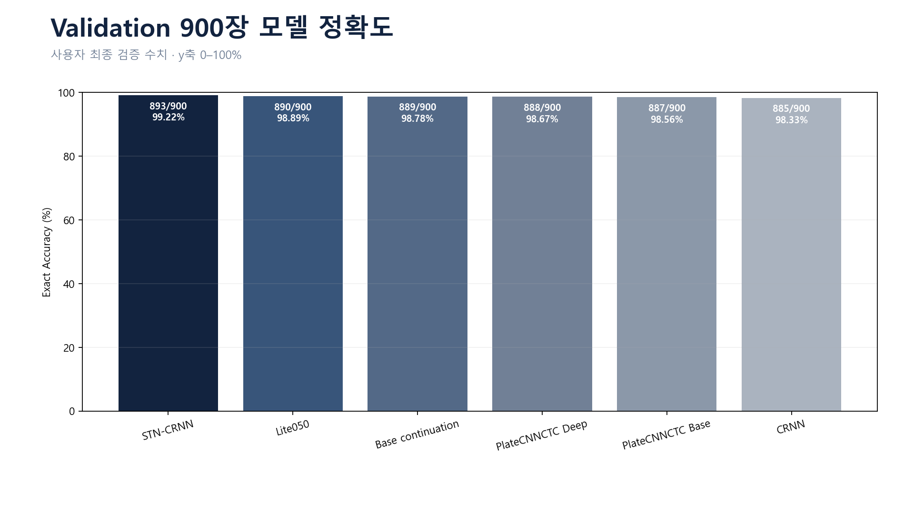

# 이석범 | AI 서비스 개발 엔지니어

> AI 모델을 실험하는 데서 끝내지 않고, API·업무 흐름·검수 체계까지 연결해 실제 서비스로 구현합니다.

## CLOUDWASH

AI 번호판 인식을 입차·예약·세차·결제·출차와 관리자 검수까지 연결한 무정차 자동 세차 운영 프로토타입

| 항목 | 내용 |
|---|---|
| 프로젝트 | [에스트래픽] 스마트 모빌리티 DX Academy 4기 팀 프로젝트 |
| 기간·인원 | 2026.06.30 ~ 2026.09.02 · 4명 |
| 담당 | OCR 데이터·모델 개발, AI API 연동, 검수 workflow, 차량 상태 제어 |
| 기술 | Python, PyTorch, YOLO11s, FastAPI, Java 17, Spring Boot, PostgreSQL, Vue 3 |

## 핵심 성과

- AI Hub 90,000장 중 1줄·7~8자리 정규 번호판 `61,922장`을 선별해 OCR 학습·검증 데이터로 구성
- 광안대교 실환경 `10,000장`을 학습 8,100장·검증 900장·locked test 1,000장으로 분리
- YOLO의 실환경 탐지 실패 `732장`을 직접 재라벨링해 Hard Sample로 재학습
- CNN-only Base가 CRNN보다 무거워진 원인을 채널 수에서 찾고, 채널 폭을 50%로 줄인 `Lite050`을 설계해 파라미터를 CRNN의 약 48%·Base의 약 25%로 축소
- 모델 선택에 사용하지 않은 OCR 전용 실사 locked test 1,000장에서, 번호판 Crop 입력 기준 문자열 완전 일치 `97.1%`
- Greedy, Beam 5·10과 번호판 형식 제약을 비교해 오답 3건을 복구하고 기존 정답 훼손 0건
- FastAPI–Spring Boot 간 이미지 요청·OCR 응답 구조를 설계하고 REST API로 구현한 뒤 통합 실행 환경에서 소프트웨어 동작 검증
- 원본 예측·confidence·이미지·bbox를 저장하고, 관리자가 문자열과 bbox를 교정해 OCR·YOLO 후속 학습 후보로 Export하는 개선 구조 구현
- 팀 회의로 보완한 입차·세차·출차 규칙을 상태 로직으로 구현하고, 중복 입차·잘못된 장비 요청·세차 및 결제 미완료 출차를 제한

## 1. 모델 선택을 실험으로 결정

번호판은 길이와 문자 위치가 구조화되어 있어 RNN 문맥 정보가 필수인지 검증하고자 CNN-only 모델을 구현했습니다. 그러나 첫 모델은 CNN 채널 수 때문에 CRNN보다 오히려 무거웠습니다.

| 모델 | 파라미터 | 실사 locked test |
|---|---:|---:|
| CRNN | 2,355,447 | 비교 기준 |
| PlateCNNCTC Base | 4,529,655 | 경량화 필요 |
| Lite050 | 1,140,503 | `971/1,000, 97.1%` |

채널 폭을 75%·50%로 재설계해 Lite050을 만들었습니다. Validation에서는 STN-CRNN보다 0.33%p 낮았지만 모델이 더 작았고, 별도의 실사 locked test와 8자리 번호판에서 더 안정적이어서 최종 모델로 선택했습니다.

`97.1%`는 번호판 Crop이 주어진 상태의 OCR 문자열 인식 성능이며 YOLO 탐지부터 포함한 end-to-end 정확도는 아닙니다. YOLO는 제한된 학습 시간으로 실환경 Crop 오류가 남았지만, 세차장에서는 광안대교보다 번호판을 일정한 위치·거리에서 촬영할 수 있다는 운영 가정 아래 OCR과 서비스 연동을 우선했습니다. 탐지 실패는 관리자가 bbox를 교정하고 재학습 대상으로 지정한 뒤 이미지와 수정 정보를 내보낼 수 있게 해, 후속 YOLO 학습으로 개선 가능한 구조를 만들었습니다.



## 2. AI 결과의 품질관리 workflow 구현

학습과 평가 과정에서 오인식이 지속되는 것을 보고, 운영 중 오류를 사람이 수정해 다음 모델 개선에 활용하는 human-in-the-loop 흐름을 설계했습니다.

```text
YOLO 검출 → Lite050 OCR → 원본 결과·confidence·bbox 저장
→ 저신뢰도·실패 로그 선별 → 관리자 문자열·bbox 교정
→ 재학습 사용 승인 → images + CSV + JSONL ZIP Export
```

실사 500장의 YOLO·OCR confidence 평균과 표준편차를 분석해 1σ·2σ 하한 정책을 비교했습니다. 일괄 0.8 기준이 499/500건을 검토 대상으로 만드는 문제를 확인하고, 검토량과 오류 포착 결과를 바탕으로 YOLO 0.748·OCR 0.930을 운영 기준 후보로 도출했습니다. 이 값은 분석 결과이며 최종 서비스 코드에 그대로 적용한 값은 아닙니다.

## 3. AI API를 실제 서비스 상태와 연결

실제 차단기·세차기 하드웨어는 연결하지 않았으며, 웹 화면과 API 요청으로 입차·세차·출차 장비 이벤트를 시뮬레이션했습니다. 세차 미완료 출차 제한은 초기 설계에서 데이터 정합성을 위해 정의했고, 중복 요청과 장비별 예외 규칙은 구현 과정에서 팀원 제안과 회의를 거쳐 보완했습니다.

OCR 성공만으로 개방 응답을 반환하지 않고 장비 유형, 블랙리스트, 열린 입차 기록, 예약·세차기 배정, 세차와 결제 상태를 순서대로 검증했습니다.

```text
차량 이미지
→ FastAPI: YOLO + Lite050
→ Spring Boot: 차량·예약·결제 조건 검증
→ PostgreSQL: 입차·세차·출차 상태 및 이벤트 기록
→ Vue: 고객·점주·관리자 화면
```

- 추론 전 입차·세차·출차 장비 유형 검증
- 동일 차량 반복 감지 시 기존 입차 ID를 반환해 중복 생성 방지
- 예약 차량을 배정 세차기로 안내하고 잘못된 장비 접근 시 재안내
- 세차 완료와 결제 완료를 모두 확인한 후 출차
- 서비스 트랜잭션과 DB 조건부 갱신으로 잘못된 상태 전이 차단

회원은 충전된 선불 잔액이 충분하면 세차 금액을 자동 차감하고, 잔액 부족 회원과 비회원은 별도 결제 완료 후 출차하도록 구성했습니다. 사업자등록이 필요한 카드·PG 기반 외부 자동결제는 프로젝트 범위에서 제외했습니다.

## 4. 예지보전 모델 선택과 운영 지표 설계

선도기업 에스트래픽 실무 담당자가 프로젝트용으로 제공한 합성 센서 데이터에서 고장 양성이 7.65%로 적어, 일반 정확도보다 PR-AUC, 고장 사건 탐지율과 장비별 오경보를 함께 평가했습니다. 로지스틱 회귀 v1·v2와 OCSVM 보조 후보를 검토한 결과, OCSVM은 이상치가 실제 7일 이내 고장으로 이어진다고 해석하기 어렵고 뚜렷한 우위를 확인하지 못했습니다.

재현성, 변수 영향 설명, 확률 보정과 운영 편의성을 고려해 13개 특징을 사용하는 L2 로지스틱 회귀를 선택했습니다. 개발환경 검증에서 PR-AUC는 0.2136에서 0.2680으로 25.5% 향상됐고, 고장 사건 탐지는 5건 중 3건에서 4건으로 증가했으며, 오경보는 장비·월 6.24건에서 3.47건으로 감소했습니다. 합성 데이터와 5개의 고장 사건에 대한 결과이므로 실서비스 성능으로 주장하지 않습니다.

## 제가 보여드릴 수 있는 역량

- 새로운 AI 구조와 decoder를 직접 비교하고 근거로 선택하는 실험 역량
- Python AI 모델을 FastAPI·Spring Boot·PostgreSQL 서비스로 연결하는 구현 역량
- AI 생성 결과의 실패 사례를 수집·평가·교정하는 품질관리 역량
- 사람이 개입하는 다단계 AI workflow 설계
- Java/Spring 기반 백엔드, REST API와 외부 API 연동
- Git 기반 4인 협업과 기능 통합

## 상세 자료

- [전체 프로젝트 소개](README.md)
- [나의 역할과 기여](docs/02_my_contributions.md)
- [OCR 모델 선택 사례](docs/03_case_study_ocr.md)
- [OCR 검수·재학습 환류 사례](docs/04_case_study_ocr_feedback_loop.md)
- [입차·세차·출차 상태 제어 사례](docs/06_case_study_gate_state.md)
- [공개용 소스 코드](source/README.md)

GitHub: [stonetiger95/kdt-teamproject-carwash](https://github.com/stonetiger95/kdt-teamproject-carwash)

> 대표 성능은 원본 locked test 97.1%입니다. corrected-v2 97.5% 결과는 정답·크롭 교정 후속 평가로 분리해 관리합니다.
