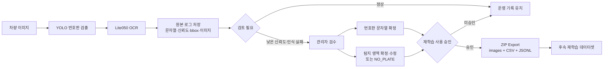

# 문제 해결 사례 2: OCR 오인식을 운영 데이터로 환류하는 검수 파이프라인

## 한 줄 요약

OCR 오인식이 차량·입차 정보의 오류로 이어지는 문제를 줄이기 위해 원본 추론 결과를 보존한 채 관리자가 번호판 문자열과 탐지 영역을 교정하고, 승인한 항목만 재학습 데이터로 내보내는 검수 기반 환류 파이프라인을 구현했다.

## 1. 문제

이 흐름은 OCR 문자열 오인식뿐 아니라 YOLO의 번호판 탐지·Crop 실패도 개선 대상으로 다룬다. 관리자가 문자열과 bbox를 각각 교정하고 재학습 후보로 승인하면, 이미지와 수정 정보를 후속 OCR·YOLO 학습에 사용할 수 있도록 내보낸다.

번호판 OCR은 정확도가 높아도 오인식을 완전히 없앨 수 없다. 운영 서비스에서는 한 글자의 오류도 다른 차량 조회, 잘못된 입차 기록과 학습 데이터 오염으로 이어질 수 있다.

이 문제는 모델 학습과 평가를 반복하는 과정에서 구체화되었다. 모델 구조와 decoder를 개선해도 촬영 환경, 탐지 영역과 유사 문자에 따른 오류가 지속적으로 발생했다. 오류 사례를 그때마다 수동으로 확인하고 끝내기보다, 서비스 운영 중 쌓이는 오인식을 관리자가 교정하고 다음 학습 데이터로 환류할 수 있다면 운영 안정성과 후속 모델 개선에 모두 도움이 된다고 판단했다.

따라서 모델 정확도를 높이는 것과 별도로 다음 장치가 필요했다.

- 신뢰도가 낮거나 실패한 결과를 운영자가 빠르게 찾을 수 있어야 한다.
- 모델의 원본 결과와 사람이 수정한 결과를 구분해 남겨야 한다.
- OCR 문자열 오류와 YOLO 탐지 영역 오류를 따로 교정할 수 있어야 한다.
- 확인되지 않은 로그가 재학습 데이터에 자동으로 섞이지 않아야 한다.
- 이미지와 정답·신뢰도·좌표를 다시 학습에 사용할 수 있는 형태로 내보내야 한다.

## 2. 전체 흐름



이 기능은 운영 로그가 모델 학습 데이터로 곧바로 들어가는 자동 학습 시스템이 아니다. 관리자의 명시적 검수와 선택을 거쳐 학습 후보를 생성하는 **human-in-the-loop 파이프라인**이다.

## 3. 원본 추론값과 검수 결과 분리

오인식을 수정할 때 기존 탐지 결과를 덮어쓰지 않았다. 다음 정보를 분리해 저장하도록 설계했다.

| 구분 | 주요 정보 |
|---|---|
| 원본 추론 | 인식 번호판, YOLO/OCR 신뢰도, 원본 bbox, 촬영 이미지와 시간 |
| 관리자 검수 | 검수 상태, 확정 번호판, 실패·의심 사유, 메모, 검수자와 검수 시각 |
| bbox 검수 | `ACCEPTED`, `CORRECTED`, `NO_PLATE`, 검수 좌표 |
| 학습 후보 | `trainingUseYn`으로 관리자가 명시적으로 지정 |

이 구조를 통해 모델이 무엇을 예측했고 사람이 무엇을 바꿨는지 추적할 수 있다. 재학습용 최종 정답을 만들면서도 원본 모델의 오류 분석 근거를 잃지 않는다.

## 4. 문자열과 탐지 영역을 독립적으로 교정

번호판 인식 실패는 OCR 문자 분류만의 문제가 아닐 수 있다. YOLO가 번호판을 잘못 자르거나 번호판이 없는 영역을 탐지한 경우에는 문자열만 수정해도 같은 오류가 반복된다.

이를 구분하기 위해 탐지 영역 상태를 세 가지로 처리했다.

- `ACCEPTED`: 기존 YOLO bbox를 그대로 사용
- `CORRECTED`: 관리자가 이미지에서 bbox를 다시 지정
- `NO_PLATE`: 번호판이 없는 이미지로 확정해 음성 후보로 처리

관리자 화면에서는 bbox를 드래그하거나 픽셀 좌표로 보정할 수 있다. `NO_PLATE`를 선택하면 좌표를 비우고, 나머지 상태에서는 유효한 좌표가 있는지 백엔드에서 검증한다.

## 5. 검토 우선순위와 입력 검증

관리자 목록은 인식 실패와 검토 필요 여부를 기준으로 우선순위를 표시한다. YOLO와 OCR 신뢰도 중 더 낮은 값을 함께 보여 주어 위험·주의·정상으로 판단할 수 있게 했다.

### 신뢰도 분포를 이용한 검토 기준 후보 분석

초기에는 YOLO와 OCR 신뢰도에 일괄적으로 0.8을 적용했지만, 무작위 실사 500장 중 499장이 검토 대상으로 분류되어 운영 기준으로 사용할 수 없었다. 이를 개선하기 위해 고정 시드로 추출한 실사 500장의 신뢰도 분포를 측정하고 평균에서 1·2 표준편차를 뺀 하한 정책을 비교했다.

| 신뢰도 | 평균 | 표준편차 | 평균−2σ |
|---|---:|---:|---:|
| YOLO | 0.767182 | 0.009730 | 0.747721 |
| OCR | 0.995046 | 0.015529 | 0.963989 |

양쪽에 2σ 하한을 적용하면 무작위 500장 중 25장(5.0%)을 검토하면서 오류 6건 중 4건을 포착했다. 다만 OCR 하한 0.964는 기존 0.94대 로그까지 대량으로 검토 대상으로 만들었다. OCR confidence가 실제 정답 확률로 보정된 값도 아니고, 일부 오인식은 0.99 이상의 confidence를 보였기 때문에 통계적 하한만을 그대로 사용하는 것도 적절하지 않았다.

분석 단계에서는 실험 결과와 예상 검토량을 함께 고려해 다음 값을 운영 기준 후보로 정했다.

- YOLO confidence `< 0.748`: 2σ 하한 0.747721을 반올림
- OCR confidence `< 0.930`: 오류 포착을 유지하면서 불필요한 검토량을 줄인 경험적 경계
- 인식 처리 오류, 빈 번호판, confidence 누락: 신뢰도와 관계없이 검토 대상
- 관리자가 이미 검수한 로그: 검토 필요 대상에서 제외

이 후보 정책은 무작위 500장 중 18장(3.6%)을 검토 대상으로 분류했고, 무작위 오류 6건 중 4건을 포착했다. 별도 실패군에서는 오류 8건 중 6건을 포착했다. 신뢰도만으로 모든 오류를 탐지할 수 없다는 한계를 확인했기 때문에 관리자 검수와 재학습 환류 기능을 함께 두었다.

단, YOLO 0.748·OCR 0.930은 분석으로 도출한 후보값이며 팀 최종 서비스 코드에 그대로 반영되지는 않았다. 최종 관리자 화면은 저장된 `needReview` 상태를 우선 사용하고, confidence 표시는 70% 미만·90% 미만 구간으로 위험·주의 수준을 시각화한다. 따라서 이 사례는 `운영 임계값 적용 완료`가 아니라 `데이터 기반 검토 정책 분석과 개선 제안`으로 설명한다.

검수 저장 시에는 다음 조건을 확인한다.

- 존재하는 로그이며 해당 관리자가 조회 가능한가
- 학습 후보로 지정했을 때 원본 이미지가 남아 있는가
- `ACCEPTED` 상태에 사용할 원본 bbox가 존재하는가
- `CORRECTED` 좌표가 유효한 범위를 이루는가
- `NO_PLATE` 상태에서 불필요한 좌표가 남지 않는가

이미지가 없는 항목을 학습 후보로 지정하려는 경우 충돌 응답으로 차단해 메타데이터만 존재하는 불완전한 학습 샘플이 생기지 않도록 했다.

## 6. 재학습 데이터 Export

관리자가 `재학습 데이터로 사용`을 선택한 항목은 관리자 전용 API에서 조회하고 ZIP으로 스트리밍한다.

```text
training-data.zip
├─ images/
│  └─ {plateDetectionLogId}.{확장자}
├─ metadata/
│  ├─ training-data.csv
│  ├─ training-data.jsonl
│  └─ missing-images.txt  # 누락이 있을 때만 생성
└─ README.txt
```

메타데이터에는 로그 ID, 이미지 경로와 촬영 시각, 원본 인식 번호, YOLO/OCR 신뢰도, 원본 bbox, 확정 번호판, 검수 상태, 검수 bbox, 검수 시각과 검수자를 포함한다.

- CSV는 스프레드시트에서도 한글이 깨지지 않도록 UTF-8 BOM을 추가했다.
- JSONL은 후속 Python 학습 파이프라인에서 행 단위로 읽기 쉽게 제공했다.
- 전체 파일을 메모리에 모으지 않고 응답 스트림에 ZIP을 작성하도록 구성했다.
- 이미지가 삭제되었거나 읽을 수 없으면 해당 샘플을 건너뛰고 `missing-images.txt`에 기록한다.

## 7. 검증

서비스 단위 테스트로 다음 동작을 확인했다.

- 검수 저장 시 로그인한 관리자 식별자가 매퍼까지 전달되는지 확인
- CSV가 UTF-8 BOM과 헤더로 시작하는지 확인
- JSONL이 샘플 하나당 한 줄로 직렬화되는지 확인
- ZIP에 CSV와 JSONL 메타데이터가 포함되는지 확인

이외에도 프런트엔드에서 저신뢰도 필터, 검토 필요 필터, 다음 검토 대상 이동, bbox 편집과 ZIP 다운로드 흐름을 연결했다.

## 8. 결과와 한계

이 기능을 통해 OCR 오류를 단순 로그로 남기는 데서 끝내지 않고 다음 세 가지를 연결했다.

1. 운영자가 잘못된 차량 정보를 바로잡는 복구 수단
2. 원본 예측과 수정 결과를 함께 남기는 오류 분석 근거
3. 검증된 이미지·라벨·bbox를 후속 학습에 사용할 수 있는 데이터셋

다만 프로젝트 범위에서는 Export 이후 모델 재학습과 재배포를 자동화하지 않았다. 구현 범위는 **사람의 승인을 거쳐 안전하게 재학습 후보를 만드는 환류 기반**까지다.

별도의 운영 기간 성과 지표가 없으므로 오인식 감소율이나 검수 시간 절감률을 임의로 제시하지 않는다.

## 9. 이 사례가 보여주는 역량

- AI 모델의 오류를 실제 서비스 운영 관점에서 다루는 설계
- 고정 임계값의 문제를 데이터 분포와 검토량으로 보정한 경험
- 원본 추론값과 사람의 교정값을 분리하는 데이터 모델링
- OCR 문자열 오류와 객체 탐지 bbox 오류를 구분하는 문제 분석
- 관리자 권한, 입력 검증과 불완전 데이터 차단
- 프런트엔드·Spring Boot·PostgreSQL·Python 학습 데이터 형식 연결
- 구현 범위와 미구현 자동화 영역을 구분해 설명하는 태도
