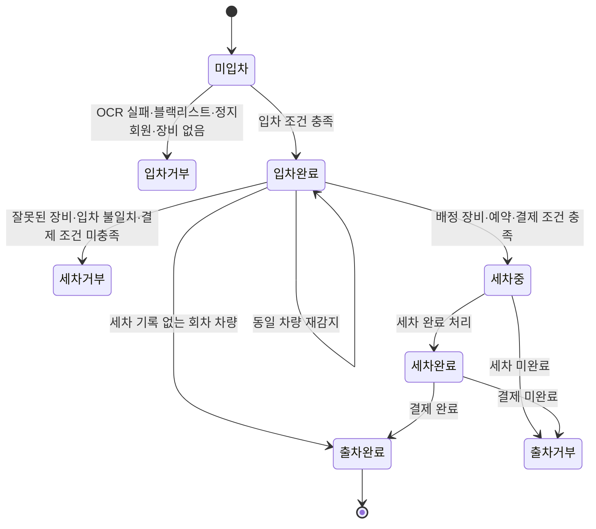

# 문제 해결 사례 3: OCR 결과를 입차·세차·출차 상태로 안전하게 연결

## 한 줄 요약

번호판 인식 성공만으로 개방 응답을 반환하지 않고 장비 유형, 블랙리스트, 열린 입차 기록, 예약·세차기 배정, 세차와 결제 상태를 순서대로 검증하는 상태 전이 로직을 구현해 차량의 입차부터 출차까지 하나의 흐름으로 연결했다.

이 프로젝트는 실제 차단기·세차기 하드웨어를 제어하지 않는다. 장비 부족과 교육 범위를 고려해 웹 화면과 API 요청으로 카메라·입차·세차·출차 이벤트를 시뮬레이션하고, 향후 라즈베리파이 등의 제어 장비를 연결할 수 있도록 소프트웨어 상태 처리에 집중했다.

## 1. 문제

OCR 서버가 번호판 문자열을 반환하는 것만으로 자동 세차 서비스가 완성되지는 않는다. 같은 번호판이라도 어느 카메라에서 감지되었는지와 현재 차량 상태에 따라 허용할 행동이 달라진다.

- 출구 카메라 요청을 입차 API로 보내면 잘못된 기록이 생성될 수 있다.
- 동일 차량이 반복 감지되면 열린 입차 기록이 중복될 수 있다.
- 입차하지 않은 차량이 세차를 시작하거나 출차해서는 안 된다.
- 예약 차량은 지정된 세차기로 안내해야 한다.
- 세차와 결제가 끝나지 않은 차량의 출차를 막아야 한다.
- 차단된 차량과 이용 정지 회원을 입차 단계에서 거부해야 한다.
- 재시도나 중복 요청이 기존 상태를 훼손해서는 안 된다.

따라서 각 API를 독립적인 CRUD로 만드는 대신 차량의 현재 상태와 이벤트에 따라 다음 상태를 제한하는 흐름이 필요했다.

세차 미완료 차량의 출차 제한은 실제 운영에서 흔히 발생할 상황이라기보다, 입차 기록이 열린 상태에서 세차·출차 데이터가 앞뒤 없이 생성되지 않도록 데이터 정합성을 지키기 위해 초기 설계에 포함했다. 중복 요청과 장비별 예외 등 세부 규칙은 구현 중 팀원들의 제안을 회의에서 검토해 보완했으며, 합의된 규칙을 백엔드 상태 로직으로 구현했다.

## 2. 상태 흐름



핵심은 `OCR 성공 = 개방 응답`이 아니라, OCR 결과를 조회 키로 사용하고 업무 조건이 모두 충족됐을 때만 상태를 변경하는 것이다.

## 3. 장비 유형을 가장 먼저 검증

입차, 세차와 출차 요청은 모두 이미지 추론 전에 장비 유형을 확인한다.

| 요청 | 허용 장비 |
|---|---|
| 입차 | `ENTRY_CAMERA`, `ENTRY` |
| 세차 | `WASH_CAMERA`, `WASH` |
| 출차 | `EXIT_CAMERA`, `EXIT` |

장비가 없으면 요청을 중단하고, API와 장비 유형이 다르면 충돌 응답을 반환한다. 잘못된 요청에서 OCR 추론과 로그 저장이 먼저 실행되지 않도록 검증 순서를 앞에 배치했다.

통합 감지 API에서는 장비 유형에 따라 입차와 출차로 분기한다. 세차 장비는 별도 세차 흐름을 사용하도록 명시적으로 안내해 서로 다른 업무 로직이 섞이지 않게 했다.

## 4. 입차 불변조건

입차 처리는 다음 순서로 진행된다.

```text
장비 확인
  → OCR 및 탐지 로그 저장
  → 인식 성공 확인
  → 블랙리스트 확인
  → 동일 번호판의 열린 입차 확인
  → 회원·정지 상태 확인
  → 세차장과 예약 확인
  → 이용 가능한 세차기 배정
  → 입차 기록과 Gate 이벤트 생성
```

주요 결정:

- OCR 실패: 차단기를 열지 않고 입차 기록도 만들지 않는다.
- 블랙리스트 차량: `ENTRY_DENIED_BLACKLIST`로 거부한다.
- 정지 회원 차량: `ENTRY_DENIED_SUSPENDED`로 거부한다.
- 이미 열린 입차가 있는 차량: 새 기록을 생성하지 않고 기존 ID를 반환한다.
- 예약과 일치하지 않아도 이용 가능한 장비가 있으면 현장 차량으로 처리한다.
- 이용 가능한 세차기가 없으면 입차 기록을 만들기 전에 거부한다.
- 회원 차량과 비회원·게스트 차량의 식별 정보를 구분해 저장한다.

반복 감지에서는 `ENTRY_ALREADY_OPEN`을 반환하고 기존 입차 ID를 재사용한다. 같은 차량이 카메라 앞에 머무르거나 요청이 재전송되어도 중복 입차 행이 늘어나지 않게 하는 멱등성 처리다.

## 5. 세차 시작 불변조건

세차 카메라에서는 번호판과 연결된 열린 입차 기록이 있어야 한다. 이후 세차장, 예약, 배정 장비, 코스와 결제 조건을 검증한다.

- 열린 입차 기록이 없으면 세차를 시작하지 않는다.
- 기존 세차 기록이 있으면 새 기록을 중복 생성하지 않는다.
- 기존 기록이 다른 세차장 소속이면 처리를 거부한다.
- 배정받은 장비와 요청 장비가 다르면 `WASH_REDIRECT`로 원래 장비를 안내한다.
- 이미 세차 중이거나 완료된 기록이면 `WASH_ALREADY_EXISTS`를 반환한다.
- 비회원 예약은 선결제 완료 여부를 확인한다.
- 회원은 충전된 선불 잔액이 충분하면 세차 금액을 자동 차감한 후 세차를 시작한다.
- 선불 잔액이 부족한 회원은 별도 결제가 필요하다.
- 비예약 비회원은 출차 전 결제가 가능하도록 `WAITING` 상태에서 시작할 수 있다.

카드·PG 기반 외부 자동결제는 결제사 연동에 필요한 사업자등록 요건을 충족할 수 없어 구현 범위에서 제외했다. 여기서 자동 처리는 외부 카드 결제가 아니라 서비스 내부의 선불 잔액 차감을 의미한다.

세차 기록 생성은 PostgreSQL 함수에서 열린 입차, 같은 세차장, 활성 세차기, 유효 코스와 예약 일치 여부를 다시 검증한다. 입차 행과 예약 행을 잠근 뒤 생성하며, 동일 입차의 중복 생성은 기존 세차 기록을 반환하도록 처리했다.

실제 `ENTERED → WASHING` 전이는 현재 상태와 고객·결제 조건을 만족하는 행만 갱신한다. 변경된 행이 0개이면 서비스는 세차 시작을 승인하지 않는다. 예약 상태도 결제와 세차 시작이 실제 승인된 뒤에만 `FULFILLED`로 변경한다.

## 6. 출차 불변조건

출차는 열린 입차 기록을 찾은 후 세차 기록의 존재 여부에 따라 분기한다.

세차 기록이 없으면 입차 후 세차하지 않고 돌아나갈 수 있는 정상적인 회차 차량으로 처리해 출차를 허용한다. 이는 오류에 대한 사후 보완이 아니라 초기 흐름 설계부터 포함한 운영 예외다. 세차 기록이 있으면 다음 두 조건을 모두 만족해야 한다.

1. 세차 상태가 `WASH_DONE`
2. 결제 상태가 `SUCCESS` 또는 `DONE`

세차 미완료와 결제 미완료는 차단기를 닫은 채 `EXIT_DENIED` 이벤트로 기록한다. 조건을 만족하면 하나의 트랜잭션 안에서 입출차 기록과 세차 기록을 종료한다. 갱신 건수가 0이면 이미 상태가 변경되었거나 조건이 달라진 충돌로 판단해 성공 응답을 반환하지 않는다.

## 7. 이벤트 기록과 추적성

상태 변경 결과와 함께 `ENTRY_OPEN`, `ENTRY_DENIED_*`, `WASH_STARTED`, `WASH_REDIRECT`, `WASH_DENIED`, `EXIT_OPEN`, `EXIT_DENIED` 등의 Gate 이벤트와 사유를 기록했다.

응답에는 차단기 개방 여부뿐 아니라 입출차 ID, 세차 기록 ID, 예약 일치 여부, 배정 장비, 세차와 결제 상태를 포함해 화면과 테스트 콘솔에서 결정 이유를 확인할 수 있게 했다.

## 8. 테스트

서비스와 컨트롤러 테스트에서 다음 시나리오를 검증했다.

- 장비 유형 불일치 시 OCR 호출 전 차단
- OCR 실패와 블랙리스트 차량 입차 거부
- 동일 차량 재감지 시 입차 중복 생성 방지
- 회원 예약, 비회원 예약과 현장 차량 입차
- 사용 가능한 세차기가 없을 때 입차 거부
- 열린 입차 기록이 없을 때 세차·출차 거부
- 배정 세차기 불일치 시 재안내
- 기존 세차 기록 중복 생성 방지
- 회원 선불 잔액의 충분·부족 여부에 따른 차감 및 세차 시작
- 비회원·잔액 부족 회원의 별도 결제 완료 여부에 따른 출차 제한
- 세차 완료·결제 완료 조건에 따른 출차 허용
- multipart 이미지와 장비 ID 요청 바인딩

## 9. 개인 기여와 협업 경계

카메라 인식 이후의 Gate 처리, 장비 검증, 중복 입차 방지, 세차 미완료 출차 차단과 회원·비회원 흐름 통합은 개인 기여가 중심이다. 예약, 결제, 선불지갑 등의 기능 자체는 공동 작업 또는 다른 팀원의 구현 영역을 포함한다. 이 사례에서는 해당 기능을 모두 직접 구현했다고 주장하기보다, 각 결과를 입차·세차·출차 상태 전이 조건에 연결하고 통합 검증한 역할에 초점을 둔다.

관련 본인 커밋:

- `391243cd0`: 카메라 인식 후 백엔드 처리 구현
- `6e8973bbe`: 세차 기록과 회원 선불지갑 잔액 차감 연결
- `b694a7efb`: 장비 유형 검증, 중복 입차 방지, 세차 미완료 출차 차단
- `b4422f6cf`: 단위 테스트
- `506a99c0e`: 예약 배정·비예약 차량·비회원 사후 결제 흐름 보완

## 10. 이 사례가 보여주는 역량

- AI 추론 결과를 업무 상태와 연결하는 백엔드 설계
- 정상 흐름보다 실패 조건과 불변조건을 먼저 정의하는 방식
- 중복 요청과 재시도를 고려한 멱등성 처리
- 애플리케이션 트랜잭션과 DB 조건부 갱신을 함께 사용한 상태 보호
- 회원·비회원, 예약·현장 이용의 분기 통합
- 다른 팀원의 예약·결제 기능을 하나의 차량 흐름으로 연결한 협업

## 담당 범위

- 세차 미완료 출차 제한: 데이터 정합성을 위한 초기 설계
- 중복 요청·장비별 예외 규칙: 팀원 제안과 회의를 통한 공동 결정
- 합의된 규칙의 서비스·DB 상태 로직 구현과 통합 테스트: 본인 담당
